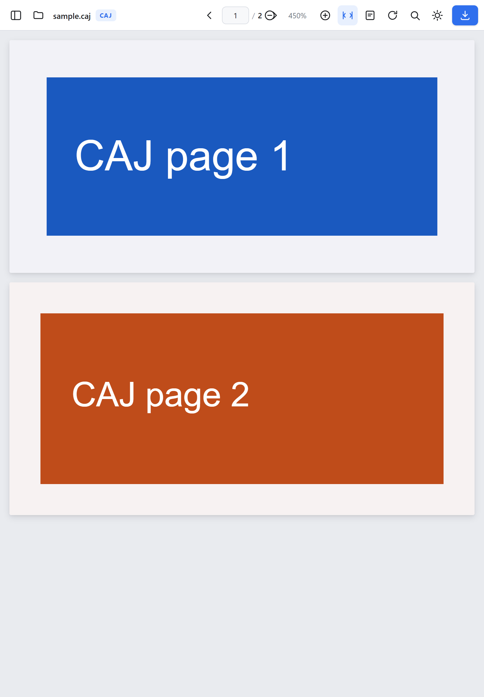
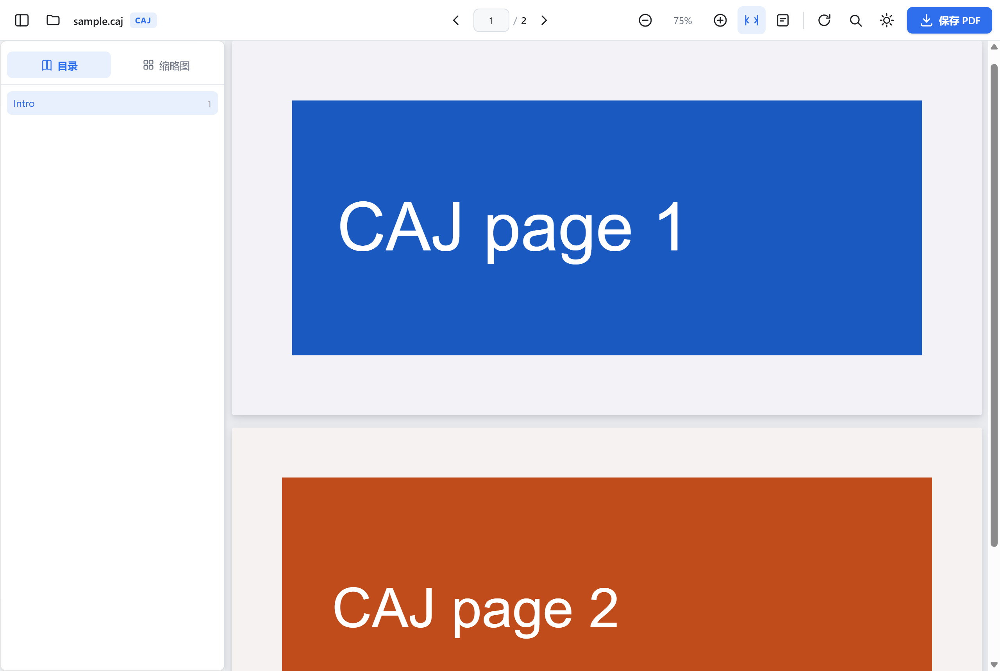
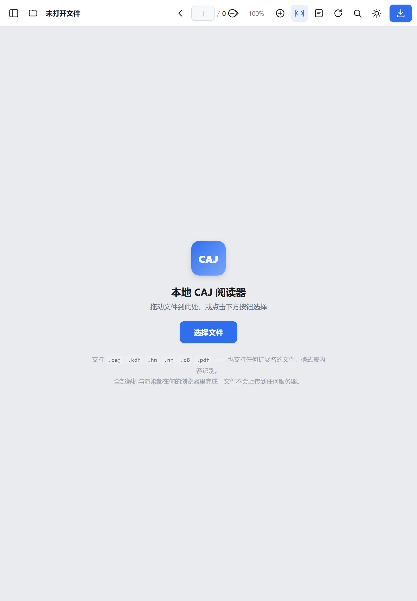
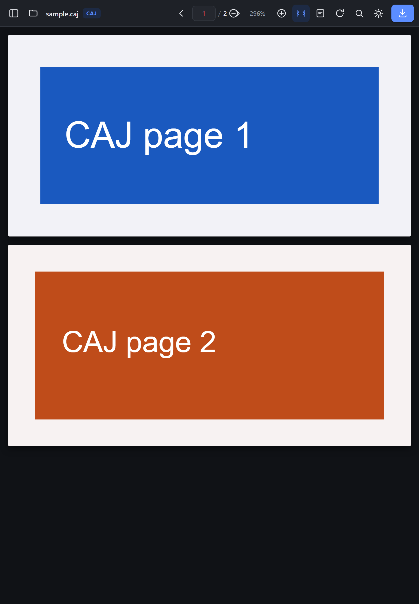

# CAJ 阅读器 · 本地浏览器版

一个**纯前端、零后端**的 CAJ 文档阅读器。把 CNKI 的 CAJ 系列文件（CAJ / KDH / HN / C8）在浏览器里转换成标准 PDF 并直接阅读——**所有解析和渲染都在你自己的设备上完成，文件不会被上传到任何服务器**。

在 iPad 和 PC 上都能用，部署方式就是「拷贝一个文件夹」。



**当前版本：2.0.0** · [2.0 更新内容](#20-更新内容) · [给 iPad 用户的随包说明](docs/ipad-users.md)

---

## 目录

- [为什么是「浏览器」而不是一个 App](#为什么是浏览器而不是一个-app)
- [快速开始](#快速开始)
  - [PC（Windows / macOS / Linux）](#pcwindows--macos--linux)
  - [iPad](#ipad) · [完整部署流程](docs/ipad-deploy.md)
- [2.0 更新内容](#20-更新内容)
- [功能](#功能)
- [格式支持情况](#格式支持情况)
- [可移植性与部署方式](#可移植性与部署方式)
- [目录结构](#目录结构)
- [测试](#测试)
- [已知限制](#已知限制)
- [用到的开源项目](#用到的开源项目)
- [许可](#许可)

---

## 为什么是「浏览器」而不是一个 App

CAJ 是 CNKI 的私有格式，只有官方 CAJViewer 能完整支持，而它**只有 Windows 版**。iPad 上过去基本无解：装不了 CAJViewer，App Store 里的第三方阅读器要么收费、要么早就下架、要么一样打不开新格式。

浏览器方案的好处在这里特别明显：

| | 原生 App | 本方案 |
|---|---|---|
| iPad 可用 | 需要 iOS 应用，几乎没有 | Safari 直接打开网页 |
| 安装 | 应用商店 / 侧载 | 复制文件夹，或者装成 PWA |
| 跨平台 | 每平台一套 | 一份静态文件通吃 |
| 隐私 | 看实现 | 结构上不可能上传——没有后端 |
| 离线 | 取决于 App | 装成 PWA 后可断网使用 |

---

## 快速开始

**唯一的前置条件**：一个能起本地静态服务的 Node.js（18+）。之所以需要它，是因为浏览器要求 http(s) 才能启用模块 Worker、WebAssembly 流式编译和 OPFS——直接双击 `index.html`（`file://`）是不行的。这个服务只负责发文件，不做任何运算。

> 应用本身**不需要 `npm install`**。所有第三方运行时都已经放在 `vendor/` 里了，下载即用。

### PC（Windows / macOS / Linux）

```bash
# Windows： 双击 start.cmd（也可以拖到命令行并跟上端口号）
# macOS / Linux：
./start.sh          # 默认 8080 端口
```

或者直接用 Node：

```bash
node serve.js                 # 默认 http://localhost:8080
node serve.js --port 9000     # 换端口
```

打开终端里打印出来的地址即可。

### iPad

iPad 上跑不了 `node`，所以有两条路：**从同一局域网的电脑上访问**，或者**把文件夹放到静态托管上**。

> 📖 **完整的逐步部署流程（含防火墙、托管体积上限、自检清单与排查）见 [`docs/ipad-deploy.md`](docs/ipad-deploy.md)。** 下面是速览。

**方式一：局域网直连（1 分钟，无需上传）**

1. iPad 和电脑连同一个 Wi-Fi。
2. 电脑上运行 `start.cmd` / `./start.sh`，记下打印出来的「局域网」地址，形如 `http://192.168.1.23:8080/`。
3. 在 iPad 的 Safari 里打开这个地址。
4. 打不开通常是 Windows 防火墙拦了 Node，允许其「专用网络」入站即可。

> 局域网 `http://` **不是安全上下文**。CAJ / KDH / HN-A / PDF 全部正常；只有 C8/HN-B 的**原生文字页**因为拿不到字体包会报错并给出提示。同时也无法离线。要完整支持请用方式二。

**方式二：静态托管（推荐，功能完整、可离线）**

```bash
node tools/make-dist.mjs          # 打包出 dist/（约 66 MB）
node tools/make-dist.mjs --without-fonts   # 约 7.3 MB，Cloudflare Pages 需要这个
```

把 `dist/` 整个目录拖到 <https://app.netlify.com/drop>（或 Cloudflare Pages / GitHub Pages），
拿到 HTTPS 地址后在 iPad Safari 打开，再「分享 → 添加到主屏幕」。

**方式三：完全不用电脑**

iPad 上装 [a-Shell](https://holzschu.github.io/a-Shell_iOS/)，进去 `cd caj-viewer && python3 -m http.server 8080`，
Safari 打开 `http://localhost:8080`。`localhost` **是**安全上下文，能力与方式二一致。

不想碰 Git 的话，可以打成一个能直接 AirDrop 过去的 zip：

```bash
node tools/make-release.mjs
```

产出 `release/caj-viewer-ipad-full.zip`（33 MB，含字体包，推荐）与
`release/caj-viewer-ipad-lite.zip`（3 MB，不含字体包）。zip 里只有一层 `caj-viewer/`
目录，还有一份 `IPAD-DEPLOY.md`。

> 📖 **这条路的逐步操作、a-Shell 注意事项与排错表见 [`docs/ipad-users.md`](docs/ipad-users.md)。**

#### iPad 上文件是灰色的、点不动？

这是 iOS「文件」App 的常见现象，跟本应用无关：

- **文件只在「最近使用」里，还没真正下载到本机。** 选择器会把它显示成灰色且不可点选。解决办法：先在「文件」App 里把它拷贝到「我的 iPad」或「iCloud 云盘」，再从本应用选择。
- 从微信 / QQ / 邮件里收到的附件，通常需要先「用其他应用打开 → 存储到"文件"」，落到本机之后才能选中。

> 本应用的文件选择器**刻意没有设置 `accept` 属性**。原因：iOS 的「文件」选择器按 UTI 过滤，而 `.caj` / `.kdh` / `.hn` / `.c8` 这些扩展名在系统里没有登记的 UTI —— 一旦限制类型，这些文件就会全部被置灰。应用本来就按**文件内容**识别格式，不依赖扩展名，所以放开限制反而更正确。

打开文件的入口用的是 `<label for="fileInput">` 的**浏览器原生激活**，不依赖 JS 调用 `input.click()` —— iOS Safari 对「程序化点击隐藏的 file input」限制很多，这是最容易表现为「按钮像死的」的地方。

#### 界面出来了，但点什么都没反应？

这是最需要警惕的一类故障。应用内置了**启动看门狗**：如果页面脚本没能执行，3 秒后会
自动弹出诊断面板，写明地址、协议、模块脚本是否执行、捕获到的具体错误，以及「怎么办」。
脚本正常但仍有问题时，点空状态里的**「运行环境自检」**，会逐项检查引擎文件、WASM 编译、
模块 Worker、存储与字符映射表。

最常见的原因只有三个：直接打开了 `file://` HTML（浏览器禁止加载模块脚本）、
静态资源没传全、服务器没把 `.js` 按 JavaScript 的 MIME 返回（Safari 比 Chrome 严格得多）。
详见 [`docs/ipad-deploy.md`](docs/ipad-deploy.md#界面出来了但点什么都没反应)。

---

## 2.0 更新内容

**阅读体验**

- **双指缩放重写**（`app/pinch.js` + `app/pinch-math.js`）。原实现一边改 `transform`、一边按焦点心算 `scrollLeft/scrollTop`，而 `transform-origin` 又是 `0 0`，数学上自相矛盾 —— 表现就是缩放中心漂移、抖动，页面滚出视野后还会剧烈跳。现在手势期间只做纯变换预览并冻结滚动，抬手时先记录真实 DOM 锚点，再按 `scale = k` 落定缩放与滚动，保证「手指按住的那个点在缩放前后不动」。合成事件驱动的几何断言在 `tests/pinch-math.test.mjs`（1616 条）。
- 双击放大与捏合互斥（双指抬手后的残留 `pointerup` 不会误判成双击）。
- **单页模式**与**页面间距**（0 / 8 / 16 / 24 px）两项目录外的阅读偏好，重启后仍然生效。

**设置与诊断**（`app/settings.js`，工具栏齿轮按钮）

- 五个分区：外观、阅读、文件、诊断、关于。
- **诊断分区**内联展示「运行环境自检」的逐项结果与建议，可导出诊断报告；「离线缓存」一行显示已缓存项数，并提供**「预热离线包」**按钮。
- 「关于」分区显示应用版本 / 构建时间 / 提交号，并按站点根的 `version.json` **「检查更新」**。

**文件管理**（`app/docs.js`，顶部标签栏）

- 同时打开多个文档，标签栏切换、关闭、`＋` 新开；打开的文档在 `IndexedDB` 里留一份副本，刷新或重新打开页面后可以恢复会话（超过 100 MB 的文件只记元信息，不存副本）。
- 关闭当前标签时自动切到相邻标签，不留空白页。
- 打开失败会回到原来的文档，不会把当前阅读位置弄丢。

**更新流程**

- 仓库根的 `VERSION` 是唯一版本号来源，`tools/inject-version.mjs` 生成 `app/version.js`。
- `node tools/release.mjs` 一条命令完成：注入版本 → 打完整包 / 轻量包（`release/*.zip`）→ 生成 `version.json`。`version.json` 会同时写到站点根、`release/` 与 `dist/`，应用里的「检查更新」就是读它。
- `tools/update-ipad.mjs` 用于**原地更新**：`node tools/update-ipad.mjs --from <目录或 zip>`。只覆盖程序文件、不动用户自己的文件，更新前自动备份到 `.releases/`（保留 3 份），支持 `--dry-run` 演练、`--list` 查看、`--rollback` 回退。

---

## 功能

**阅读**

- 连续滚动，页面按需渲染；远离视野的页面会被回收，长文档在 iPad 上也不会撑爆内存（默认最多保留 16 页画布，视野内更密集时以视野为准）
- 缩放：适应宽度 / 适应整页 / 25%–800% 自由缩放；**双指捏合**、**双击**放大、`Ctrl`+滚轮
- 旋转 90°，深色主题（可跟随系统），扫描件反色阅读
- 目录（来自 CAJ 书签）与缩略图侧栏；iPad 竖屏时自动变成浮层抽屉
- 文本层：可以选中、复制
- 查找：`Ctrl`/`⌘`+`F`，全文高亮，上下跳转
- 键盘快捷键：`←` `→` `PgUp` `PgDn` `Home` `End`、`+` `-` `0`、`w`（适应宽度）

**文件**

- 拖放、文件选择器（`<label for>` 原生激活，iOS 上不依赖 JS）、PWA「打开方式」关联
- 打开时自动识别真实格式（**按内容而不是扩展名**——很多 `.caj` 其实就是个 PDF）
- 转换进度与取消；导出为 PDF
- 出错时按错误码给出中文提示，而不是抛一个英文异常
- **自带诊断**：脚本没能启动时自动弹出诊断面板；另有「运行环境自检」逐项检查引擎、Worker 与存储

| 桌面端 | iPad（空状态） | 深色模式 |
|---|---|---|
|  |  |  |

---

## 格式支持情况

转换引擎是 [`caj2pdf-rust`](https://github.com/rwv/caj2pdf-rust) 的 WebAssembly 构建（MIT）。它按**文件字节**判定格式，扩展名只作参考。

| 输入 | 状态 |
|---|---|
| **PDF** (`%PDF-`) | ✅ 直通渲染（含常见结构修复），不经过转换器，零等待 |
| **CAJ** (`CAJ`) | ✅ 完整支持，含目录书签 |
| **KDH** (`KDH`) | ✅ 支持其中的内嵌 PDF |
| **HN-A** | ⚠️ 实验性：扫描页图片 + 书签，无文字层（可后续 OCR） |
| **C8 / HN-B** | ⚠️ 实验性：图片页与原生文字页。原生文字需要内置字体包 |
| **CAA** | ❌ 只是「目标描述符」，需要拿到它指向的文档 |
| **TEB** | ❌ 已识别，但转换尚未实现 |

> 关于 HN/C8：上游把它标为实验性。渲染布局可能与 CAJViewer 有差异，C8/HN-B 的目录结构尚未验证（会省略并给出提示）。不支持的组合会**明确报错**，而不是静默丢页。

`vendor/caj2pdf-rust/caj2pdf-fonts-v1.bin`（约 58.6 MiB）是 C8/HN-B 原生文字页用的字体包，**只在那类文档第一次转换时按需下载**，不影响打开速度。如果你只读常见的期刊 CAJ，可以删掉它以节省 58 MB——届时 C8/HN-B 原生文字会给出明确错误。

---

## 可移植性与部署方式

这是本方案的主要卖点，具体体现在：

1. **零后端、零数据库。** 没有服务端逻辑，也就没有服务端可移植性问题。任何一个能发静态文件的东西都能托管它。
2. **零构建步骤。** 没有 webpack/vite/tsc，源码就是运行的代码。改一行刷新即可。
3. **零运行时依赖安装。** 第三方代码全部已 vendor 到 `vendor/`，`index.html` 打开即用。
4. **纯静态 + 相对路径。** 所有资源引用都是相对路径，放在域名根目录或任意子目录都能工作。
5. **一份代码覆盖 PC 与 iPad。** 用同一套响应式布局和指针事件，桌面端用鼠标/键盘，触屏用捏合/双击。
6. **可离线。** 带 Service Worker：安装为 PWA 后断网也能启动（外壳与访问过的 vendor 资源自动进缓存）。想保证「离线打开一本没读过的 C8/HN-B 文档」也没问题，点自检面板里的**「预热离线包」**一次性缓存全部运行时 + 字体包（约 65 MB）；预热清单里每一项都会在打包测试里核对是否真的存在。
7. **降级是显式的。** 缺少 `SharedArrayBuffer`（未跨源隔离）或 OPFS 时，应用照常工作，只是失去背压/即时取消或 C8 原生字体；不会莫名其妙地坏掉。

**跨源隔离（可选）**：`serve.js` 默认发送 `Cross-Origin-Opener-Policy` / `Cross-Origin-Embedder-Policy`，让页面成为 `crossOriginIsolated`，从而启用 `SharedArrayBuffer`——转换器因此可以对 Worker 施加背压、并能立即取消。用 `--no-isolation` 可关闭。自建托管时记得配上这两个头。

**浏览器要求**：需要支持模块 Worker 与 WebAssembly 的现代浏览器——Chrome/Edge 89+、Firefox 114+、**Safari 15+（iPadOS 15+，实测下限见下）**。

> ⚠️ **关于 iPadOS 版本**：`vendor/pdfjs/build/` 里是 pdfjs-dist **6.x** 的构建产物（**不是** legacy 构建），它运行期用到 `Promise.withResolvers`、`Uint8Array.fromBase64`、`Object.hasOwn`、`Array.prototype.at` 等较新的标准方法。`app/compat.js` 会在页面最早期补齐这些缺失的方法（已随部署包发布，不需要联网）。
>
> 补齐之后仍然存在**语法层面**的硬门槛，这些无法用垫片解决：#private 字段与 `static {}` 初始化块需要 **Safari 14.1+**，顶层 await 需要 **Safari 15+**。因此本项目的实际下限是 **Safari 15 / iPadOS 15**；`iPadOS 14 及更早`打不开，只能走 PC 端。
>
> 如果你确实需要更老的 iPadOS：把 `vendor/pdfjs` 换成 pdfjs-dist 的 `legacy/build/`（同时把引用改回 `.mjs` 会踩 MIME 坑，见下文「修复记录」——建议改名为 `.js`），并重跑 `npm test`。

---

## 目录结构

```
caj-viewer/
├── index.html                 界面骨架（含内联 SVG 图标，无外部图标依赖）
├── app/
│   ├── app.js                 全部应用逻辑（转换流水线、渲染、交互）
│   ├── compat.js              旧版 Safari 兼容垫片（必须在 app.js 之前加载）
│   ├── style.css              样式（深色/浅色、响应式、安全区适配）
│   ├── icon.svg               PWA 图标（矢量，favicon）
│   └── icon-180/192/512.png   主屏图标（由 tools/make-icons.mjs 生成；iOS 不认 SVG）
├── sw.js                      Service Worker（离线缓存 + 可手动预热离线包）
├── manifest.webmanifest       PWA 清单
├── _headers                   静态托管用的响应头（Cloudflare Pages / Netlify 会读取）
├── serve.js                  零依赖静态服务器（跨源隔离、Range、局域网）
├── start.cmd / start.sh       一键启动脚本
├── vendor/                    ★ 第三方运行时，开箱即用，无需 npm install
│   ├── caj2pdf-rust/          CAJ→PDF 的 Rust/WASM 引擎（MIT）
│   │   ├── browser.js         浏览器入口
│   │   ├── internal/worker.js 转换 Worker
│   │   ├── caj2pdf_wasm.wasm  引擎本体（~2.4 MB）
│   │   └── caj2pdf-fonts-v1.bin  C8/HN-B 字体包（~58.6 MB，按需加载，可删）
│   └── pdfjs/                 Mozilla PDF.js 6.x（Apache-2.0；注意不是 legacy 构建）
│       ├── build/             pdf.min.js + pdf.worker.min.js
│       ├── cmaps/             中日韩字符映射表
│       ├── standard_fonts/    标准字体度量
│       └── wasm/              JBIG2 / JPEG2000 / QCMS 解码器
├── tools/
│   ├── make-dist.mjs          打包出可直接上传的 dist/
│   ├── make-release.mjs       打成可 AirDrop 到 iPad 的 zip（完整版 + 轻量版）
│   └── make-icons.mjs         从零栅格化主屏图标（零依赖，无需 ImageMagick）
├── docs/
│   ├── ipad-deploy.md         ★ iPad 部署流程（逐步 + 排查）
│   ├── ipad-users.md          零 Git 路线：zip 传进 a-Shell + localhost 使用说明
│   └── shots/                 README 用截图
├── dist/                      打包产物（.gitignore，随时可重建）
├── release/                   AirDrop 用 zip（.gitignore，node tools/make-release.mjs 重建）
└── tests/
    ├── make-fixtures.mjs      生成合成 CAJ / PDF 测试样本
    ├── smoke.mjs              Node 侧冒烟测试（转换 + 校验）
    ├── browser-e2e.mjs        真实无头 Chrome 端到端测试
    ├── dist-smoke.mjs         对即将上传的 dist/ 做部署前检查
    ├── update-vendor.mjs      升级 vendor/ 中的第三方版本
    └── compat-probe.mjs       升级 vendor 后核对 iPadOS 兼容下限（只读，无断言）
```

---

## 测试

三层验证，都不需要安装 npm 依赖。

**第一层：Node 侧转换正确性**

```bash
node tests/make-fixtures.mjs     # 生成 tests/fixtures/sample.caj 与 sample.pdf
node tests/smoke.mjs             # 12 项断言
```

用合成 CAJ（2 页 + 1 个书签）验证：格式识别、页数、书签数、输出是合法 PDF、PDF 直通路径。
`tests/make-fixtures.mjs` 里的合成容器严格按 CAJ 头部布局构造，所以这个样本本身也是格式说明的活文档。

样本一共四个：`sample.caj`（2 页）、`sample.pdf`（1 页）、`sample-long.caj`（24 页）、`sample-long.pdf`（60 页）。

**第二层：真实浏览器端到端**

```bash
node tests/browser-e2e.mjs       # 80 项断言
```

启动本地静态服务 + 无头 Chrome（通过 CDP 直连，无第三方依赖），在真实浏览器里跑完整流程：

- 外壳加载、跨源隔离生效、初始浮层全部隐藏
- **文件选择器形态**：两个入口都是 `<label for>` 原生激活、输入框不是 `display:none`、没有 `accept`（这三条直接决定 iPad 上点不点得动）
- **环境自检**：逐项检查引擎文件、WASM 编译、模块 Worker、存储、CMap，并确认本机环境全部通过
- CAJ → WASM 转换 → PDF.js 渲染 → **逐像素确认真的画出了东西**
- 文本层生成、目录书签、缩略图、查找高亮、导出 PDF 有效性
- PDF 直通路径
- 错误处理（乱码文件给出中文提示且不影响后续操作）
- **iPad 竖屏视口**：适应宽度、工具栏不遮挡、侧栏转浮层、深色主题、纵向/横向滚动、惰性渲染上限
- **iPad 冷启动**：直接以窄屏加载时侧栏默认收起
- **老 iPad 兼容**：在页面里把 `Promise.withResolvers` / `Uint8Array.fromBase64` / `Object.hasOwn` / `Array.prototype.at` 等较新方法删掉再加载，验证 `app/compat.js` 会补回来、补回来的方法行为正确、pdf.js 仍可加载且应用仍能启动
- **长文档滚动回归**：24 页 CAJ 与 60 页 PDF 从头滚到尾，逐屏核对**每一页都真的画出了内容且带文本层**；再缩小到 19% 触发页面回收后重滚一遍；最后滚回顶部确认被回收过的页面能重新出现
- **部署容错**：把 `WebAssembly.compileStreaming` 换成必定失败，模拟「托管把 `.wasm` 发错 MIME」，验证引擎能退回一次性编译并照常工作
- **启动看门狗**：用 CDP 拦掉 `app/app.js`，验证页面会自己弹出诊断面板说明「脚本未加载」，而不是静默地什么都点不动
- **访问保护（401）诊断**：伪造一张密码保护页，验证面板指出「被访问保护拦截」并给出关闭路径
- **模块依赖链诊断**：让 `pdf.min.js` 返回 404（入口正常、依赖坏掉，正是线上真实踩过的形态），验证面板指名的是**依赖**而不是入口
- **双指缩放（2.0）**：派发真实 `TouchEvent` 序列，逐帧核对「预览变换与父容器位置一致」「手势期间滚动被冻结且不发生跳动」「抬起后焦点处的文档点仍在同一屏幕位置」
- **设置面板（2.0）**：齿轮按钮开关、五个分区各自渲染出内容、诊断分区拿到的是自检结果、关于分区显示版本号
- **多文档标签（2.0）**：连续打开多个文档后标签数正确、切换标签能挂回各自的页面容器、关闭激活标签后自动切到邻居且不留空白、刷新后能从 `IndexedDB` 恢复会话
- **阅读设置真的生效（2.0）**：单页模式下只显示当前页、页面间距选中值落到 `#pages` 的实际布局上、重启后偏好仍然生效
- **更新产物（2.0）**：页面能读到版本号与站点根的 `version.json`，`IPAD-UPDATE.md` 随包存在
- 无未捕获异常、无控制台错误

截图落在 `tests/out/e2e/`。当前状态：**80 / 80 通过**（Node 侧 12 / 12，双指几何 1616 / 1616，部署产物 10 / 10）。

> 无头 Chrome 需要能创建命名管道来做 Mojo IPC，因此在强沙箱环境里可能起不来（表现为 `OpenProcess: 拒绝访问`）。这是环境限制，不是测试本身的问题。

**辅助工具：兼容下限探针**

```bash
node tests/compat-probe.mjs      # 只读，打印命中的特性名，无断言、不在 npm test 里
```

升级 `vendor/` 之后跑一下：它会列出 pdf.js 与 caj2pdf 运行时用到的较新语法 / API。
命中**能垫的方法**就补进 `app/compat.js`；命中**垫不掉的语法**（`static{}`、`#private`、
类静态字段等）就要同步上调 README 与 `docs/ipad-deploy.md` 里的最低系统版本。

**第三层：部署产物自检**

```bash
node tools/make-dist.mjs
node tests/dist-smoke.mjs        # 10 项断言
```

拿真正要上传的 `dist/` 起一个服务，检查最容易翻车的几件事：必需资源是否齐全
（漏传 `app/` 或 `vendor/` 会白屏）、`.wasm` 的 MIME 是否为 `application/wasm`、
COOP/COEP 是否生效、中文 CMap 与 JBIG2 解码器是否就位、**离线预热清单里的每一项
是否都真的存在于产物中**、目录穿越是否被挡住。
当前状态：**10 / 10 通过**。

### 修复记录

**2.0 顺手查出来的缺陷**

- **阅读偏好重启后不生效** —— 设置面板把「页面间距 / 单页模式」存在自己的 key 里，启动时只读取不落地，于是重启回到 0 / 连续滚动。现在 `ensureSettingsPanel()` 读完偏好立刻 `applyReadingPrefs()`。
- **页面间距白名单不一致** —— 设置面板提供 0/8/16/24，而内部白名单是 0/8/16/28，选 28 会被静默夹成 16。现在统一成 0/8/16/24。
- **老文档标签留下孤儿页面容器** —— 多文档改造后，打开新文件时旧文档的 `#pages` 有时没被摘掉，viewport 上会挂着两个同 id 的容器（其中一个永远为空）。现在挂载时会把残留容器摘掉，`tests/browser-e2e.mjs` 增加了一条断言盯着它。

**iPad 版本门槛说错了 / 老 iPad 上点开文件没反应** —— 已修复。
README 与文档原先宣称「PDF.js 用的是 **legacy 构建**，对较旧的 iPadOS Safari 更宽容」。
实际 `vendor/pdfjs/build/` 里是 pdfjs-dist **6.x 的标准构建**，它运行期要
`Promise.withResolvers`（Safari 17.4+）、`Uint8Array.fromBase64`（Safari 18.2+）、
`Object.hasOwn` 与 `Array.prototype.at`（Safari 15.4+）。缺任何一个，最先炸的地方是
**加载 PDF 的过程中**，表现成「点开文件没反应」，在 iPad 上根本看不到原因。

修法是加一层 `app/compat.js`（经典脚本，排在 `app/app.js` 之前）：只补齐缺失的标准方法，
不改写已有实现，不需要联网。补齐之后剩下的硬门槛只有语法层面的
（#private 与 `static {}` 需 Safari 14.1、顶层 await 需 Safari 15），即 **iPadOS 15+**。
`tests/browser-e2e.mjs` 里加了三条断言：把那些方法删掉再加载页面，验证垫片会补回来、
补回来的行为正确（base64 解码 / `at(-1)` / `hasOwn`）、pdf.js 仍可加载且应用仍能启动。

**iPad 添加到主屏后没有图标** —— 已修复。
原来 `manifest.webmanifest` 与 `apple-touch-icon` 都只给 `app/icon.svg`，
而 iOS **不把 SVG 当主屏图标**，结果装到桌面是网页截图或空白方块。
现在用 `tools/make-icons.mjs`（纯 Node，自写 CRC32 + `zlib.deflateSync`，无第三方依赖、幂等）
生成 `app/icon-180.png` / `icon-192.png` / `icon-512.png`（不透明、带 3×3 超采样抗锯齿），
`index.html` 的 `apple-touch-icon` 指向 PNG，manifest 的 icons 也用 PNG 并带一个 `maskable` 条目。

**离线承诺没兑现 / Service Worker 可能把 HTML 兜底页当脚本下发** —— 已修复。
原来只有「访问过的」vendor 文件才会进缓存，所以「装到主屏后断网也能用」在首次离线时
并不成立；而且 `SHELL_FILES` 的匹配用 `pathname.endsWith()`，在把 404 回退成 `index.html`
的静态托管上，缺文件会被当成 HTML 缓存下来、再被当成脚本下发（浏览器报 MIME 错）。

现在 `sw.js` 支持 `postMessage({ type: 'cache-vendor' })` 预热协议：按固定清单并发 3 路抓取、
回传进度，单个失败不中断；清单覆盖引擎的 ES 模块闭包（`io.js`、`internal/bundled-fonts.js`、
`internal/font-pack.js`）、PDF.js 的四个 wasm 解码器、标准字体与中日韩 CMap，共 62 项、约 65 MB。
子资源（`.js/.css/.wasm/.bin/.bcmap/.json`）永远不下发 HTML 兜底页，但**保留原状态码**，
因为应用自己的启动探测靠 HTTP 401/404 判断是谁拦的。自检面板新增「离线缓存」一行与
**「预热离线包」**按钮；`tests/dist-smoke.mjs` 增加一条断言，核对清单里每个路径都真实存在于产物中。

**部署到静态托管后「界面在、脚本没跑」** —— 已修复。
这是本项目最容易被误诊的一类故障：页面外壳正常显示，但 `app/app.js` 加载失败，
报错还指向 `app.js` 自己（`Failed to fetch dynamically imported module: …/app/app.js`），
而它明明 `HTTP 200 · application/javascript`。

真正的原因是 **`vendor/` 里的模块用了 `.mjs` 后缀**：很多托管（含 Netlify）不把 `.mjs`
当成 JavaScript 下发，而是 `application/octet-stream`；浏览器对模块脚本执行**严格 MIME 检查**，
于是整个模块图被拒绝执行。本地一直没暴露，是因为 `serve.mjs`
是自己写的、明确把 `.mjs` 映射成了 `text/javascript` —— **只有真正部署出去才会踩到**。

修法是**从根上不依赖托管商的 MIME 表**：`tools/normalize-vendor.mjs` 把 vendor 里所有
`.mjs` 统一改名为 `.js`（并重写文件内部的模块说明符），本地服务器也一并改名成 `serve.js`；
`tests/dist-smoke.mjs` 增加了「部署产物中不含 `.mjs`」的兜底检查。现在整个产物只用 `.js`，
是任何托管都正确处理的后缀。

同时给启动看门狗加了**模块依赖链探测**：入口脚本正常却加载失败时，它会顺着 `import`
把整条依赖链走一遍，直接指出第一个失败的文件（此前这类故障只能靠猜）。这条路径有测试守着
—— 用 CDP 让某个依赖返回 404，验证面板指认的是「依赖」而不是入口。

**只有界面、点什么都没反应（iPad）** —— 已修复。
打开文件的入口原本是 `<button>` + JS 调用 `input.click()`，而那个 input 带着 `hidden`
（即 `display:none`）。**iOS Safari 对「程序化点击一个 `display:none` 的 file input」
很不可靠**，表现就是按钮像死的；而没打开文件时，整个应用确实没有别的可操作项。
现在两处入口都改成 `<label for="fileInput">` 的**浏览器原生激活**，输入框也改为
「移到角落 + 全透明」而不是 `display:none`，这条路上不再依赖 JS。

顺带补了两个此前完全缺失的能力：**启动看门狗**（脚本没能执行时，3 秒后就地弹出诊断面板，
写明协议、模块是否执行、捕获到的错误与「怎么办」）和**环境自检**（逐项检查引擎文件、
WASM 编译、模块 Worker、存储、字符映射表）。iPad 上没有开发者工具，静默失败等于无法排查 ——
这两样把「点不动」变成了「照着提示做」。

**空白页（滚动时出现一片永远不消失的白页）** —— 已修复。
根因是 `IntersectionObserver` 只在页面「进入 / 离开」观察范围的那一刻回调一次。一旦某页在可见范围内被回收、或那一次渲染被打断，观察器**不会再发第二次通知**，这一页就永久空白。这个缺陷有明确特征：从第 16 页开始全白（16 恰是内存回收的页数上限）。

修法是让渲染不再只依赖观察器事件：滚动时主动对账一次「视野范围内还没画出来的页面」，并把内存回收限制在**渲染范围之外**。现在即使某页因任何原因被清空，只要它还在视野附近，下一帧就会被补回来。

---

## 已知限制

- **HN / C8 是实验性的**，这是上游引擎的现状。图片页正常，原生文字页依赖字体包，布局与 CAJViewer 可能有差异。
- **TEB 不支持**，CAA 只是描述符。加密 PDF 不支持。
- **没有 OCR。** HN-A 这类纯扫描文档没有文字层，因此不能选中文字或查找。需要的话可以对导出的 PDF 跑 `ocrmypdf`。
- **大文件吃内存。** 转换结果会在内存里拼成 Blob（浏览器通常落盘）。几百 MB 的扫描件建议在 PC 上处理。
- **iOS 上的下载**受 Safari 行为影响；实在不行可以用「分享 → 存储到文件」。
- 局域网 `http://` 下 C8 原生文字字体不可用（非安全上下文），见上文。

---

## 用到的开源项目

本项目是把两个成熟的开源组件组装成一个可用的阅读器，核心的格式解析与渲染都不是我写的：

| 项目 | 作用 | 许可 |
|---|---|---|
| [**rwv/caj2pdf-rust**](https://github.com/rwv/caj2pdf-rust) | CAJ / KDH / HN / C8 → PDF 的 Rust 引擎及其 **WebAssembly** 构建。本项目的基石——没有它就不可能在浏览器里解析 CAJ。 | MIT |
| [**mozilla/pdf.js**](https://github.com/mozilla/pdf.js) | PDF 解析与渲染（`pdfjs-dist` 6.x 的标准构建，不是 `legacy`；旧版 Safari 的支持由 `app/compat.js` 垫片提供） | Apache-2.0 |
| [caj2pdf](https://github.com/caj2pdf/caj2pdf) | 更早的 Python 实现，CAJ 格式的社区研究源头 | MIT |

许可全文见 `vendor/caj2pdf-rust/LICENSE`、`vendor/caj2pdf-rust/FONT-NOTICES.txt`、`vendor/pdfjs/LICENSE`。

---

## 许可

本项目自身代码以 MIT 许可发布。第三方组件的许可见上表及 `vendor/` 内的许可文件。
